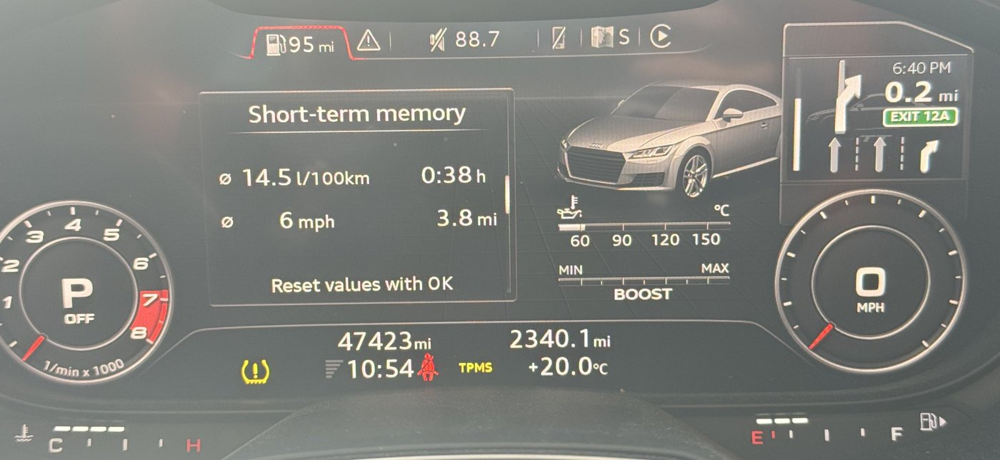
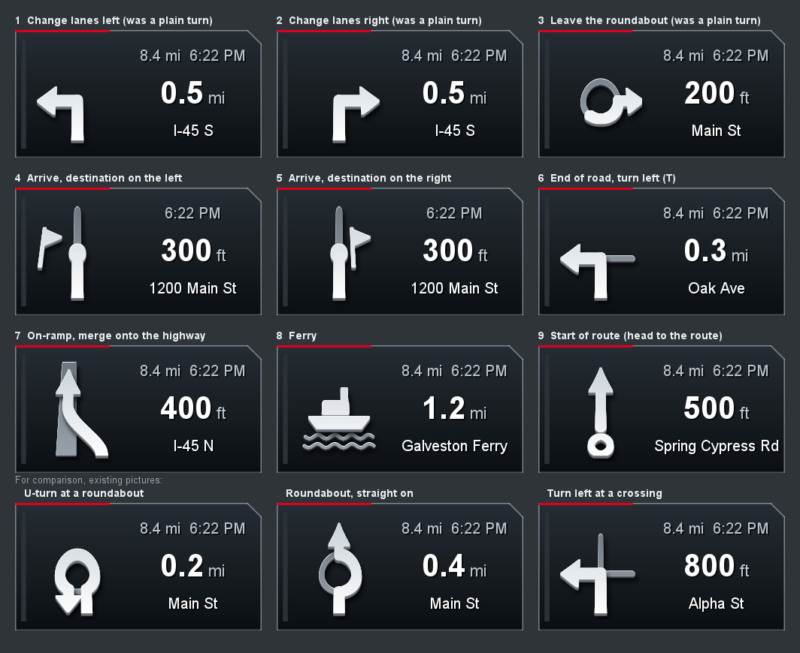

# CarPlay on the Audi TT 8S Virtual Cockpit

Apple Maps and Google Maps from CarPlay on the Audi TT 8S Virtual Cockpit, with
turn-by-turn guidance drawn in the cockpit's guidance banner.

Target: **MHI2_US_AU43x_P5180 / MU1462 (G24)**, Nvidia Tegra MHI2, QNX 6.5.
Based on [aberbic's Audi-MHI2-Virtual-Cockpit-Altscreen](https://github.com/aberbic/Audi-MHI2-Virtual-Cockpit-Altscreen-CarPlay-AndroidAuto)
(GPL-3.0, MU1438). Its full history is kept here, and its code still does much
of the work.

> **Works on one car (US TT, MU1462).** It modifies system files on the head unit
> and can stop CarPlay working. Do not install it on any other firmware. You need
> root SSH or M.I.B. access, a parked car and stable power.

## What works

| Feature | State |
|---|---|
| CarPlay map on the cockpit map tab, switched automatically | Works |
| Large and small (tach-centred) cockpit views | Works |
| Steering-wheel scroll zoom on the CarPlay map | Works |
| Turn-by-turn panel: 3D arrows, lanes, exit badge, distance, ETA | Works; first drives in progress |
| Android Auto | Not ported to the TT |

Details, the dead ends and what is next: **[the TT wiki](ports/tt-8s-mu1462/wiki/Home.md)**.
Built with Claude Code; how, and how to start on your own car: [Working with Claude](ports/tt-8s-mu1462/wiki/Working-with-Claude.md).

## Where things are

| Path | Contents |
|---|---|
| [`ports/tt-8s-mu1462/`](ports/tt-8s-mu1462/README.md) | The TT port: installers, HMI source, test kit, tools, wiki |
| `carplay/`, `hmi/`, `scripts/`, `toolbox/`, ... | The upstream MU1438 project the port builds on |
| [`UPSTREAM-README`](UPSTREAM-README), `INSTALL` | Upstream documentation (MU1438, CarPlay and Android Auto) |

## Installing

There is no one-click package yet. The current installers are in
`ports/tt-8s-mu1462/package/` (see its `README.txt`), and the newest HMI jar is
installed with the `kit/tt.sh` toolkit. An SD-card (M.I.B.) installer is planned.

No firmware, patched stock files or converted HMI jars are in this repository;
the port's `scripts/` rebuild them from your own firmware copy.

## Credits and licence

GPL-3.0 (see LICENSE and NOTICE). Built on:

- [aberbic/Audi-MHI2-Virtual-Cockpit-Altscreen-CarPlay-AndroidAuto](https://github.com/aberbic/Audi-MHI2-Virtual-Cockpit-Altscreen-CarPlay-AndroidAuto)
  and the work it credits ([harman-f](https://github.com/harman-f), [luka-dev](https://github.com/luka-dev),
  [f-io/LIVI](https://github.com/f-io/LIVI), [binarybase](https://github.com/binarybase))
- [luka-dev/mib2q-carplay-rgi](https://github.com/luka-dev/mib2q-carplay-rgi)
- [yuedizhibo/MHI2Q-CarPlay-AltScreen](https://github.com/yuedizhibo/MHI2Q-CarPlay-AltScreen)
- [chefranov](https://github.com/chefranov)'s route-guidance hook from
  [tehfalcon-vw/mhi2-nar-carplay-maps](https://github.com/tehfalcon-vw/mhi2-nar-carplay-maps) (used, not included)

Full list: [Credits](ports/tt-8s-mu1462/wiki/Credits.md).
