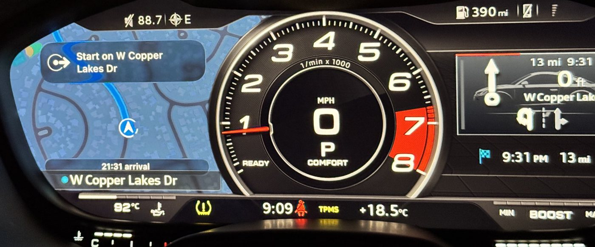
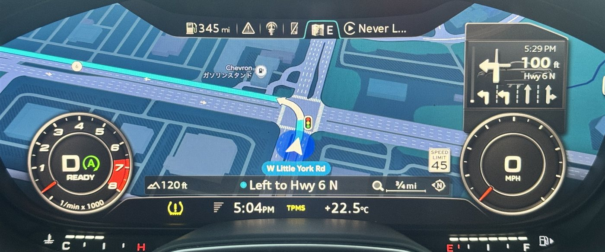

# CarPlay on the Audi TT 8S Virtual Cockpit

Apple Maps and Google Maps from CarPlay on the Audi TT 8S Virtual Cockpit, with
turn-by-turn guidance drawn in the cockpit's guidance banner.

Target: **MHI2_US_AU43x_P5180 / MU1462 (G24)**, Nvidia Tegra MHI2, QNX 6.5.
Based on [aberbic's Audi-MHI2-Virtual-Cockpit-Altscreen](https://github.com/aberbic/Audi-MHI2-Virtual-Cockpit-Altscreen-CarPlay-AndroidAuto)
(GPL-3.0, MU1438). Its full history is kept here, and its code still does much
of the work.

> **Works on one car (US TT, MU1462).** It modifies system files on the head unit
> and can stop CarPlay working. Do not install it on any other firmware. You need
> root SSH or M.I.B. access, a parked car and stable power.

## Made for the TT

The TT is not like the cars the upstream project targets. It has **one screen** (the cockpit is
the head unit's own picture), an **MMI-Kombi** cockpit that ignores BAP turn data, and a stock nav
banner that only draws routes from Audi's own nav engine. A straight port shows a map and nothing
else.

This port was built on the car itself: **more than 60 versions** (HMI jar v1-v56, renderer builds,
supervisors), each tried on a real TT, with **over 30 hours of in-car testing and logging**. That
includes drives, parked tests and crash hunts with a live system-log recorder. Every feature below
was made for the TT's screen, views and software, not carried over from another car.

This version adds:

| | What it does | Why the TT needs it |
|---|---|---|
| **Turn panel where Audi puts its own** | Our guidance panel sits in the stock banner position: 3D turn arrows, lane arrows (preferred lane highlighted), exit badge ("EXIT 12A"), distance, arrival time, progress bar. It uses the stock frame on the car tab, its own frame over the map, and moves next to the tach in the Sport view | The stock banner cannot show iPhone turns: [8 attempts](ports/tt-8s-mu1462/wiki/Stock-guidance-dead-ends.md) proved it draws only from Audi's own route |
| **Route guidance from the iPhone** | Google Maps and Apple Maps send turns, lanes, distances and ETA over iAP2. We receive them in the HMI, keep the merged state, pick the right lane set and convert the ETA to the cockpit clock | Without it there is no turn data on the head unit at all ([how](ports/tt-8s-mu1462/wiki/Turn-by-turn-data.md)) |
| **Instructions in the stock bottom strip** | The cockpit's own strip reads "Left to Hwy 6 N" or "Right to Alpha St" as you approach a turn, then shows the current road again | Reads like the stock nav and lets the iPhone's card stay off |
| **iPhone card optional** | The map shows full width by default; `card auto` brings the app's card back near turns | The card can't be made see-through and hides a lot of a 1440x540 screen |
| **Sport (small) view layout** | When the cockpit shrinks the map to the side of the big tach, the picture shifts 453 px so the route stays visible | iOS ignores a change of the safe area mid-session; [shifting in the renderer](ports/tt-8s-mu1462/wiki/CarPlay-map.md#small-view-layout) does work |
| **Steering-wheel zoom** | The scroll wheel zooms the CarPlay map; optional auto zoom near turns | The stock zoom only scales Audi's map |
| **Real-time display handover** | The CarPlay tab and our cockpit map share the display controller's few hardware windows. Our renderer keeps its window for the whole session and only switches its picture (about 40 ms). It watches the screen state itself every 25 ms and keeps a shadow of a write-only toggle register. The supervisor has no blocking IPC left. The map comes back in about a third of a second | This was the "CarPlay goes black, then the iPhone disconnects" crash. It is gone in normal switching ([the whole story, with diagrams and the RTOS view](ports/tt-8s-mu1462/wiki/Display-window-handover.md)) |
| **TT plumbing** | Video output 0 on display 0, layer 60 in the TT's map contexts (including map + banner), TCP 6031 opened in the stock firewall, MMI-Kombi code paths handled | The upstream values are for a different display layout ([differences](ports/tt-8s-mu1462/wiki/TT-differences.md)) |
| **Test kit** | `tt.sh`: one-command install and undo, a live system-log recorder that survives crashes, timestamped marks, parked tests | Rare faults are found from evidence, not guesses |

How the parts fit together: [system architecture](ports/tt-8s-mu1462/wiki/Architecture.md).

## What works

| Feature | State |
|---|---|
| CarPlay map on the cockpit map tab, switched automatically | Works |
| Large and small (tach-centred) cockpit views | Works |
| Steering-wheel scroll zoom on the CarPlay map | Works |
| Turn-by-turn panel: 3D arrows, lanes, exit badge, distance, ETA | Works |
| Bottom strip with the next turn ("Left to Alpha St"), auto zoom near turns | Works |
| Switching between the map and the CarPlay tab without drops | Works for normal switching ([how it was fixed](ports/tt-8s-mu1462/wiki/Display-window-handover.md)) |
| Android Auto | Not ported to the TT |

Details, the dead ends and what is next: **[the TT wiki](ports/tt-8s-mu1462/wiki/Home.md)**.
Built with Claude Code; how, and how to start on your own car: [Working with Claude](ports/tt-8s-mu1462/wiki/Working-with-Claude.md).

 

## Known issues

**Very fast switching between the map and the CarPlay tab can drop CarPlay.** This means flipping
back and forth several times within a couple of seconds, staying on the CarPlay tab for less than
about half a second each time. When it happens, the CarPlay session ends and restarts on its own
after about 10 seconds; rarely the phone needs a replug.

- Normal switching is not affected. In the last test (run60) 26 of 27 CarPlay-tab openings were
  fine; the one drop was the third tab flip in 2 seconds.
- It is not the old crash. There is no display-window conflict. The CarPlay video connection
  itself fails when the tab reopens 0.15 s after it closed.
- **No fix is planned for now.** Nobody switches like that while driving, and chasing it would
  mean changing timing in the stock CarPlay stack for no real-world gain. Background:
  [Display-window handover](ports/tt-8s-mu1462/wiki/Display-window-handover.md).

**Rarely, the stock "straight on" arrow shows instead of our turn panel.** This was seen once, on a
long drive. After switching to the Sport view during a route, the cockpit's right window showed
Audi's own guidance picture (a plain straight arrow, with our distance and arrival time) instead
of our panel. It stayed until the MMI was restarted (hold the MMI knob). It has not been
reproduced parked, not even by replaying the recorded messages from that drive, so the cause is
still open. If you see it, please don't restart the MMI straight away: park, save the logs
(M.I.B. action `logs`, or `sh tt.sh bug what you saw` over SSH), then restart.

## Bug reports

Open an issue with what you saw, the cockpit clock time, the view (Classic or Sport) and, if
you have them, the logs saved before the MMI restart.

## Where things are

| Path | Contents |
|---|---|
| [`ports/tt-8s-mu1462/`](ports/tt-8s-mu1462/README.md) | The TT port: installers, HMI source, test kit, tools, wiki |
| `carplay/`, `hmi/`, `scripts/`, `toolbox/`, ... | The upstream MU1438 project the port builds on |
| [`UPSTREAM-README`](UPSTREAM-README), `INSTALL` | Upstream documentation (MU1438, CarPlay and Android Auto) |

## Installing

There is no one-click package yet. The current installers are in
`ports/tt-8s-mu1462/package/` (see its `README.txt`), and the newest HMI jar is
installed with the `kit/tt.sh` toolkit. An SD-card (M.I.B.) installer is planned.

No firmware, patched stock files or converted HMI jars are in this repository;
the port's `scripts/` rebuild them from your own firmware copy.

## Support

This is a free, spare-time project: the code, the 60+ versions and the hours in the car cost
nothing to use. If it made your TT better and you'd like to give something back (a coffee, the AI
tokens it was built with, the gas for test drives, or the time), you can:

Entirely optional. Bug reports with logs from your car help just as much.

## Credits and licence

GPL-3.0 (see LICENSE and NOTICE). Built on:

- [aberbic/Audi-MHI2-Virtual-Cockpit-Altscreen-CarPlay-AndroidAuto](https://github.com/aberbic/Audi-MHI2-Virtual-Cockpit-Altscreen-CarPlay-AndroidAuto)
  and the work it credits ([harman-f](https://github.com/harman-f), [luka-dev](https://github.com/luka-dev),
  [f-io/LIVI](https://github.com/f-io/LIVI), [binarybase](https://github.com/binarybase))
- [luka-dev/mib2q-carplay-rgi](https://github.com/luka-dev/mib2q-carplay-rgi)
- [yuedizhibo/MHI2Q-CarPlay-AltScreen](https://github.com/yuedizhibo/MHI2Q-CarPlay-AltScreen)
- [chefranov](https://github.com/chefranov)'s route-guidance hook from
  [tehfalcon-vw/mhi2-nar-carplay-maps](https://github.com/tehfalcon-vw/mhi2-nar-carplay-maps) (used, not included)

Full list: [Credits](ports/tt-8s-mu1462/wiki/Credits.md).
