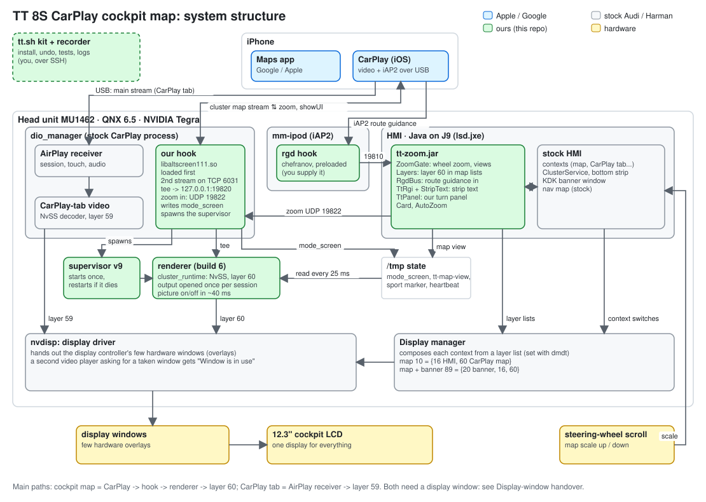

# System architecture

[Home](Home.md)

Everything that takes part when an iPhone runs CarPlay maps on the TT's Virtual Cockpit, as of
renderer build 6, supervisor v9 and tt-zoom.jar v56. Blue = Apple/Google, grey = stock Audi/Harman,
green = ours, yellow = hardware. (Drawn by `scripts/mkarch.py wiki/images/architecture.svg`; regenerate rather than hand-edit.)

## What each part does

### On the iPhone

| Part | Does |
|---|---|
| **Maps app** (Google Maps / Apple Maps) | Draws two things: the normal CarPlay screen, and a separate "instrument cluster" map sized for the cockpit (1440 x 540) |
| **CarPlay (iOS)** | Sends both as H.264 video over the USB link (a network interface called `carplay0`). Also sends route guidance (turns, distances, lanes, ETA) over iAP2 when asked |

### Stock head-unit software (Audi / Harman, unmodified except where noted)

| Part | Does |
|---|---|
| **dio_manager** | The stock CarPlay process. Its AirPlay receiver runs the session (touch, audio, the CarPlay tab's video). Patched in one place: our hook is loaded as its first library |
| **CarPlay tab video** | Inside dio_manager: decodes the main CarPlay screen with NvSS onto **layer 59** when you open the CarPlay tab, stops it when you leave |
| **mm-ipod** | The stock iAP2 (Apple accessory protocol) service over USB |
| **HMI (lsd.jxe)** | The whole cockpit and MMI user interface, in Java. Decides which screen ("context") shows, draws the stock nav map, the bottom strip and the KDK banner |
| **Display manager** | Composes the screen from layers. Each context has a layer list, e.g. map = {16 HMI, 60 CarPlay map}; the CarPlay tab has its own. `dmdt` is its command-line tool |
| **nvdisp** | NVIDIA's display driver. Hands out the display controller's few hardware windows (overlays) to video players. Two players cannot hold the same window: the second gets "Window is in use" |

### Ours (GPL, in this repository)

| Part | Does |
|---|---|
| **libaltscreen111.so** (the hook) | Runs inside dio_manager. Hooks the stock AirPlay session so the iPhone is also asked for the cluster map stream; receives it on TCP 6031 (opened in the firewall); copies it to the renderer over the local "tee" port 19820. Takes zoom datagrams (UDP 19822) and turns them into `changeMapZoomLevel`; sends `showUI` (map with or without the iPhone's card). Writes the session state (`mode_screen`: 1 = CarPlay tab, 2 = car screens) to `/tmp/mibr-alt111-gen2.status`. Spawns the supervisor |
| **cluster_supervisor.sh v9** | Starts the renderer once the map has been up 1 s, restarts it if it dies (at most 3 times in a row). No other job any more |
| **cluster_runtime** (the renderer, build 6) | Connects to the tee, decodes the cluster map with NvSS onto **layer 60**. Opens its video output once per session and keeps it. Watches the screen state every 25 ms: picture off on the CarPlay tab, on everywhere else (output attribute byte 60 is a toggle; it keeps a shadow of the state). Shifts the picture left in the Sport skin's small view. Writes a heartbeat file while it draws |
| **tt-zoom.jar** (HMI overrides) | Java classes loaded ahead of the stock HMI. `ZoomGate`: steering-wheel zoom to the hook, view and skin state, Sport marker. `Layers`: puts layer 60 into the map contexts while the renderer's heartbeat is fresh; writes `tt-map-view`. `RgdBus`: receives route guidance on 19810. `TtRgi` + `StripText`: feed the stock strip ("Left to Alpha St"). `TtPanel`: our turn panel in the banner window. `Card`, `AutoZoom`: the iPhone's card and zoom near turns |
| **tt.sh kit** | Install, undo, report, tests, recorder (`rec on`), log saving. Run over SSH |

### Third party, supplied by the user

| Part | Does |
|---|---|
| **librgd_hook.so** (chefranov) | Preloaded into mm-ipod: asks the iPhone for iAP2 route guidance and forwards it to 127.0.0.1:19810. Not redistributed; the installer checks its hash |

## The main paths

1. **Cockpit map:** Maps app -> CarPlay -> USB -> hook (TCP 6031) -> tee 19820 -> renderer -> NvSS
   layer 60 -> nvdisp window -> LCD, shown when the Display manager's current context lists 60.
2. **CarPlay tab:** CarPlay main stream -> AirPlay receiver -> NvSS layer 59 -> nvdisp window -> LCD.
   Paths 1 and 2 share the display controller's windows: see
   [Display-window handover](Display-window-handover.md).
3. **Turn-by-turn:** iPhone iAP2 -> mm-ipod + rgd hook -> 19810 -> RgdBus -> turn panel, bottom strip,
   iPhone card timing, auto zoom.
4. **Zoom:** steering wheel -> stock HMI scale change -> ZoomGate -> UDP 19822 -> hook ->
   `changeMapZoomLevel` -> iPhone redraws the cluster map.
5. **Screen switching:** HMI changes context -> Display manager composes the new layer list; the
   AirPlay receiver reports the mode change -> hook writes `mode_screen` -> renderer reacts within 25 ms.

More detail: [Components](Components.md) (files and install locations), [How the TT differs](TT-differences.md).
