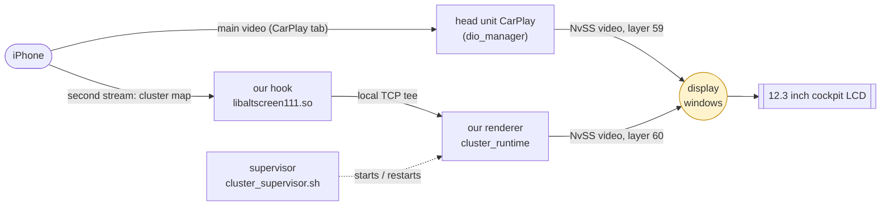
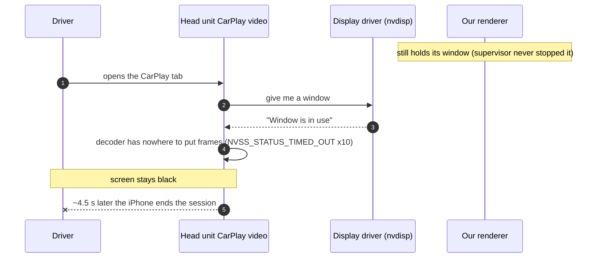
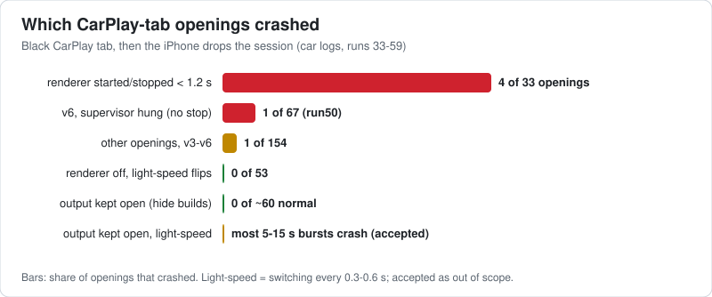
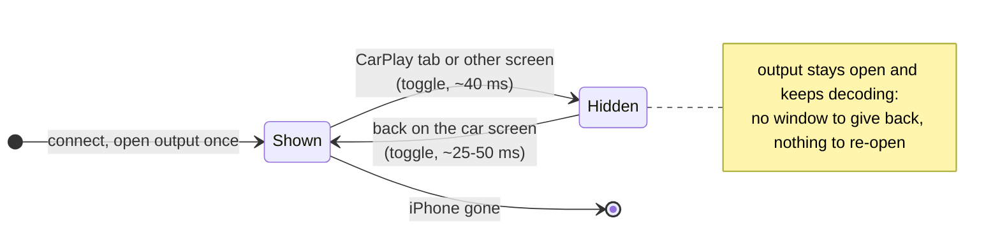
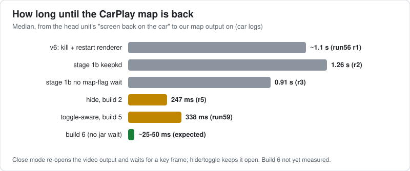

# The CarPlay-tab crash and the display-window handover

[Home](Home.md)

> **In one sentence:** the head unit's own CarPlay video and our cockpit map renderer both need
> one of the display's hardware windows, and every crash happened when one of them was opening
> or closing its window while the other wanted it. The fix was to stop opening and closing:
> the renderer keeps its window for the whole session and only switches its picture on and off.

Status (November 2026): fixed for normal switching with renderer build 5 + supervisor v9 (run59)
and build 6 (run60: 26 of 27 openings fine, map back 11-93 ms after the screen change, no
"Window is in use"). Build 6 + v9 + tt-zoom v56 is the v1.0.0 release set.

Switching faster than about every half second can still drop CarPlay. In run60 the drop came on
the third tab flip in 2 s, with a different signature from the old crash: no "Window is in use".
The head unit's screen stream started its decoder 0.16 s after the previous teardown and got
`kConnectionErr` (-6753) at once; the session restarted by itself about 8 s later. This is
accepted as out of scope, with no fix planned.

## What it looked like

You open the CarPlay tab. Normally it is black for a moment, then CarPlay shows. In a crash it
stays black, and about 4 seconds later the iPhone disconnects; sometimes it needs a replug.
Rare (about 1 opening in 30-90), so a drive rarely caught one.

## The pieces

Two video players, one display controller with a small number of hardware windows (overlays).
The display driver (`nvdisp`) hands a window to whoever opens a video output first.

## What actually went wrong

The decisive capture (run50, with `sh tt.sh rec on` recording the system log live):

Two different things made our renderer hold the window at the wrong moment:

1. **The supervisor hung.** It asked the display manager for the current screen with `dmdt gs`,
   synchronously. Sometimes the display manager never answered, so `dmdt` blocked forever and so
   did the supervisor (process watch: supervisor in `REPLY` on the pipe, `dmdt` in `REPLY` on the
   display manager). From then on nobody stopped the renderer. Runs 41, 49, 50 and 51.
2. **Kill-and-restart was too slow.** When it worked, the supervisor polled every 0.2 s and then
   killed the renderer. Closing a video output takes 100-300 ms more. The head unit asks for its
   window about 30-300 ms after the tab opens. Sometimes we lost that race (run51, 321 s).

## The fix: keep the window, switch the picture

- The renderer (built from source with `-DMU1462_TT`) opens its video output once per session.
- It watches the hook's status file itself every 25 ms (no supervisor round trip).
- Leaving the map: picture off. Back on the car: picture on. Decoding never stops, so there is no
  key-frame wait.
- Supervisor v9 only starts it and restarts it if it dies. It makes no `dmdt` calls, so it
  cannot hang.

### The trap: attribute byte 60 is a toggle

The video attributes have a byte at offset 60 that the original code sets to 1 when it opens the
output. We read it as "visible". It is not. **Writing 1 flips the output, writing 0 does nothing,
and reading it back always gives 0.** It works like an edge-triggered command, not a level.

How we found out: build 4 wrote it 5 times on each return to the map. The driver's marks
alternated perfectly over 11 returns: *map-blank-map-blank-map*, then *blank-map-blank-map-blank*.
That is an odd number of toggles per return. Build 5 keeps the state itself and writes 1 only to
change it. `sh tt.sh attr toggle` shows it on the car.

## How fast it is now

To the eye, everything from build 5 on feels immediate: the cockpit's own screen transition is
slower than we are.

## The same problems in RTOS terms

Mostly not scheduling: resource ownership and synchronisation, with one deadline problem.

| What happened | Classic name | Textbook fix | Here |
|---|---|---|---|
| Two video players fight over a hardware display window; the second gets "in use" and stalls | Shared resource without mutual exclusion (no owner, no arbiter) | One owner, or an explicit acquire/release protocol | The renderer keeps its window for the whole session |
| The supervisor killed the renderer only after it saw the tab open | Race condition: release and acquire not ordered | A handshake: the acquirer waits for the holder's release | Not needed once nothing is released; the hook could still gate it (stage 2) |
| Poll up to 200 ms + kill + close 100-300 ms (800 ms under load), vs the head unit taking its window 30-300 ms after the tab opens | Missed deadline: worst-case time of the release path > deadline | Shorten the critical path, or remove it | Removed: hiding the picture takes about 40 ms and releases nothing |
| The 0.2 s poll never saw 25 ms CarPlay views during light-speed flipping | Sampling instead of events (aliasing) | Event-driven notification | 25 ms self-watch; a hook pulse would be the full fix |
| The supervisor stuck forever in `dmdt`, waiting on the display manager | Unbounded blocking on synchronous IPC (QNX: client REPLY-blocked), no watchdog | IPC timeouts (`TimerTimeout`), async pulses, a watchdog | No `dmdt` in the loop at all |
| Byte 60: writing 1 flips the output, reading back always 0 | Write-only, edge-triggered register treated as a level | Shadow register: keep the state, write only on change | Build 5 |
| Light-speed flipping still crashes | Thrashing: requests faster than the system settles | Debounce, hysteresis, rate limiting | Accepted as out of scope |

Where scheduling does come in: closing an output took 100-250 ms normally but up to 800 ms while the
head unit decoded at the same time (CPU/GPU contention sets the worst case), and the display
manager's hang may have been a priority inversion inside it; our logs only show our side.

## What we learned (the honest version)

| Mistake | Better |
|---|---|
| Changed the supervisor 6 times on theories (v3-v8) before capturing one crash | Capture first: a live system-log recorder found the real error on the first crash |
| Counted crashes from drives (about 1 in 30-90 openings) | Rates need about 100 openings per variant, or a measurable precursor ("Window is in use") |
| Blocking IPC (`dmdt`) in the control loop, no timeout | Never block a supervisor on another server; no `dmdt` in the loop at all |
| "Release" = kill the process | Keep the resource; switch its state |
| Assumed a write sets a state | Check the write semantics (the read-back was useless; the user's eyes were not) |
| Features and fixes in the same versions | Feature freeze while hunting; one variable per test |
| No common clock across logs | Renderer, hook and system log now share the realtime clock |

Turning points: the baseline with the renderer off (0 crashes in 53 openings, even with
light-speed flipping), the process watch (`pidin` states every 2 s), and precise visual marks
from the driver (`sh tt.sh mark ...`).

## Tools this left behind

| Command | Does |
|---|---|
| `sh tt.sh rec on` | Live system log + process watch to RAM (survives crashes and SSH logout) |
| `sh tt.sh mark TEXT` | Puts a marker into every log at that moment |
| `sh tt.sh handover` / `handover undo` | Installs / removes renderer build 6 + supervisor v9 (flash) |
| `sh tt.sh attr toggle\|zero\|crop N\|dump` | Attribute experiments on the live output |
| `sh tt.sh save` | Copies the logs; prints the copy command for that run only |

Raw evidence: car runs 33-59 (not in git). `scripts/crashtable.py RUNS_DIR` lists every
CarPlay-tab opening in saved runs with the renderer state around it and whether it crashed.
