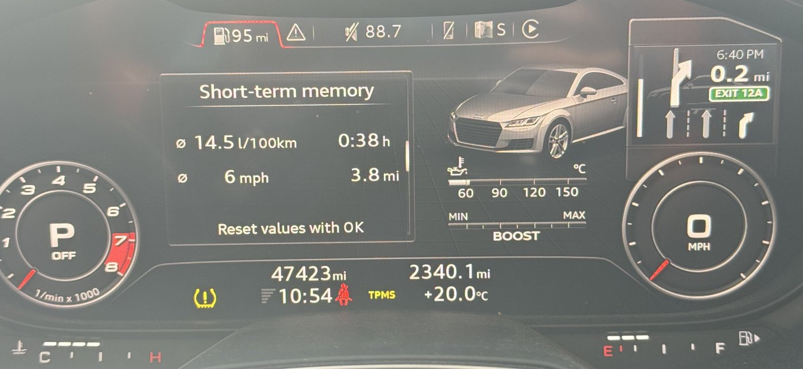
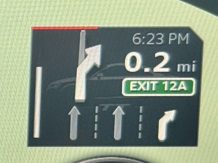
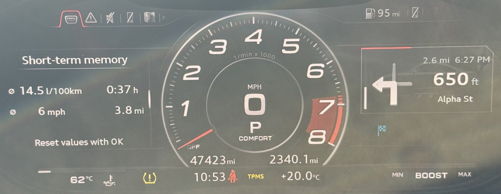
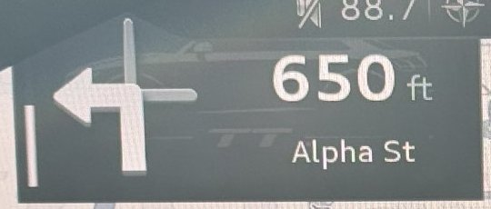
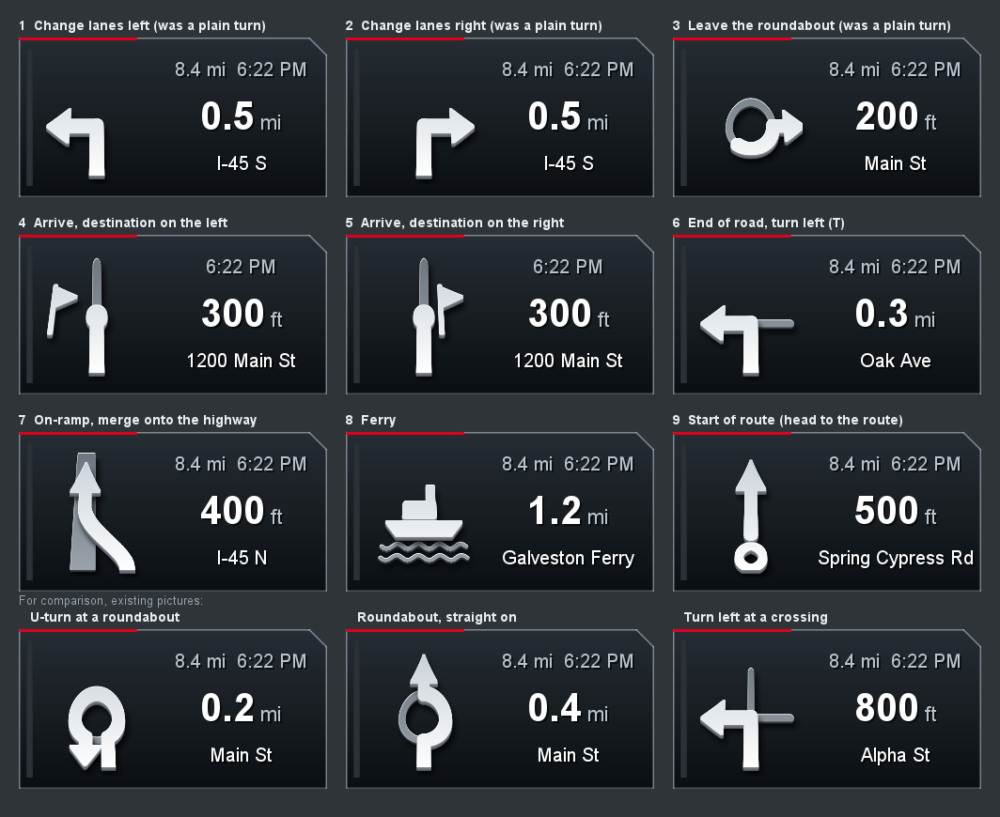

# Turn panel

[Home](Home.md)

Our own guidance panel, drawn in the stock banner window on every view (map tab
included), fed live from the iPhone ([Turn-by-turn data](Turn-by-turn-data.md)).

On the car (v33/v34, parked demo):

| Classic view, car tab (stock frame) | Classic view, map tab (own frame over CarPlay) |
|---|---|
|  |  |

| Sport view, car page | Sport view, panel over the map |
|---|---|
|  |  |

All pictures, drawn by the car code on the PC:

## Layout

| View | Panel | Frame |
|---|---|---|
| Small (tach-centred), car page | 328x170 at 991,160, just under the trim line | Our own: chamfered top-right corner, light border, red accent |
| Small, map showing (v35) | 328x170 at 130,76, over the map left of the tach (the banner window is gone with the banner off) | Our own |
| Large, car tab | 210x150 at 1105,110 | The stock frame |
| Large, map tab (v33) | 210x150 at 1105,110, over the CarPlay map | Our own (stock banner off, it hides the map) |

- Left: thin cylinder-shaded progress bar, then the maneuver picture, centred in its area.
- Right column, rows spread evenly and each centred: top line (Sport view:
  distance to destination and arrival time; Classic view: arrival time), big
  distance with a small unit, green "EXIT 12A" badge, street.
- Without an exit number the street becomes the main line; without lanes it
  moves to the bottom.
- Lanes run across the bottom during the approach: preferred white, good light
  grey, others dark. A lane with two directions shares one stem.
- Geometry lives in `KdkLayout`, shared by the picture and the text nodes.
- Text: HMI fonts with a dark shadow node. The distance shrinks instead of being
  cut; the top line tightens, shrinks, then drops AM/PM before using "...".

## Rendering

All in plain Java (no AWT on the car), in `PanelArt.kdkStyled`, off the HMI thread:

1. Gradient background, then the user's picture (optional, see below).
2. Frame (Sport view only).
3. Maneuver drawn flat at 2x, split into route (white) and side streets (grey),
   laid on the road in perspective, then extruded with side walls, a lit top
   face, an edge highlight and a blurred shadow.
4. Lanes: flat dashes, raised arrows. Exit badge.
5. The static part is cached per maneuver; a bar update only copies it and
   redraws the bar. A full draw takes 10-15 ms on the car.

**Background picture:** `/mnt/app/root/tt/panel-bg.a8`, a centred, faint alpha
mask with its proportions kept, made with `scripts/mkbg.py`. Pictures stay out of
git; without the file there is no background.

## Pictures

| Picture | Code | iAP2 types |
|---|---|---|
| Turn (slight / normal / sharp) with side streets | 13 | 1, 2, 3, 6, 16, 47-51 |
| Highway exit | 15 / 16 | 8, 22, 23 |
| Fork / keep left or right | 19 | 13, 14 |
| Roundabout with the exit taken | 21 / 22 | 28-46 |
| U-turn | 25 | 4, 18, 26 |
| U-turn at a roundabout | 21 / 22, dir 128 | 19 |
| Follow road | 11 | 0, 5 |
| Arrival flag | 3 | 10, 12, 27 |
| Arrive, destination left / right | 3, dir 64 / 192 | 24, 25 |
| Leave the roundabout | 26 / 27 | 7 |
| On-ramp merge | 40 | 9 |
| End of road (T) | 41 | 20, 21 |
| Start of route | 42 | 11 |
| Change lanes left / right | 43 | 52, 53 |
| Ferry | 44 | 15, 17 |

Codes 40-44 are TT-local: `RgdBus.stockSafe` never passes them to the stock
cluster. Code 12 stays stock's "prepare" icon, so lane change got its own code.

## Stock banner behaviour

- The stock banner is on for a CarPlay route in every view; `/tmp/tt-rgi-nokdk`
  turns it off.
- Its picture is kept at opacity 0 while our panel is up ([Cockpit drawing](Cockpit-drawing.md#stock-banner-handling)).
- After our panel goes, the banner stays transparent (no black box); stock
  navigation fades its own banner back in.

## History

| Version | Change | Result |
|---|---|---|
| v19-v20 | First EAL nodes | Drew, after fixing texture and font argument order |
| v21 | Real panel (300x340) at the banner spot | Too big in the Classic view; hidden in the Sport view |
| v22-v23 | Compact panel; then left/right banners on the map | Banners drew but were clipped by the screen's corners; the stock frame covered the Sport view |
| v24-v26 | Banner opacity, own viewport 225, pre-rendering | v26: first drawing visible on the cockpit |
| v27 | One 210x150 panel in the stock frame everywhere ("original style"), opacity watcher, calibration grid | Flash gone; window sizes measured |
| v28 | Wide 328x170 panel under the trim line in the Sport view | Fit; looked like a pasted-on slab, "1..." cut-offs |
| v29-v30 | TT-styled frame, 3D arrows, exit badge, background picture, centred layout (five PC mockups first) | Looked right; pink text, cut top line |
| v31 | RGBA text colours, top-line fitting | |
| v32 | Nine new pictures, fixed roundabout U-turn, research log | Pictures as previewed; live route: the stock banner hid the CarPlay map |
| v33 | Banner off while the map shows (context 10/89), own frame on the map, full-screen grid | Map kept on live Google and Apple routes in every view; banner back on the car page. At a playback start the banner stayed up about 11 s |
| v34 | Map check reads the live context; the watcher runs for as long as a route is declared | Photos: CarPlay map + framed panel on the large map, panel in the stock frame on the car pages. Sport view with the map: map kept, panel not visible (its window is gone) |
| v35 | Sport view with the map: panel over the map at 130,76; U-turn lanes drawn as a hook; street names shrink before "..." | Test pending |
| v44 | The iPhone's own card per view: Classic with card, Sport map only (`local.tt.Card`: writes `/tmp/mibr-alt111-url-mode` base/map on each view change and touches `/tmp/mibr-alt111-show-only`, so the hook re-sends `showUI` mid-session); kit `card auto|off|on|left|right|top|default` | Works: Sport map only confirmed (photos); side card positions squeeze the 400 px safe window and shift the app's ETA bar |
| v45 | Banner only near turns on the CarPlay map (`RgdBus.nearTurn`: next turn or destination within 1 km, motorway exits and forks 2 km; also 10 s at route start, 5 s after a turn), faded over about 0.3 s with the panel node's opacity (hidden fully at 0); background 65% opacity on the CarPlay map (`PanelArt.bgAlpha`), solid elsewhere. The stock banner picture stays transparent. Kit `banner auto|always|alpha N` (`/tmp/tt-panel-always`, `/tmp/tt-panel-alpha`) | Not what the user meant (they meant the iPhone's card); made opt-in in v46 |
| v46 | Our banner back to always shown and solid by default (`sh tt.sh banner auto` / `alpha N` opt in). The iPhone's card now shows only near turns in both views (`local.tt.Card.route`, same distances, 10 s at route start, 5 s after a turn, at most one switch per 4 s); position top via `sh tt.sh card top` | Test pending |
| v47 | Auto zoom at turns on the CarPlay map (`AutoZoom`, see [CarPlay map](CarPlay-map.md#auto-zoom-at-turns-v47)); kit `autozoom` | Test pending |
| v48 | Fixes from car photos: v45-v47 called the panel node's `setOpacity(1f)` on every redraw, which hid the picture (black box, text only); now the opacity is only touched during a fade, scaled from the node's own value. Arrival time showed UTC (4:09 AM for 22:09): the HMI's UTC offset is 0 on the TT, so the time is now the cockpit clock (`getKombiTime`) plus the phone's `time_remaining_seconds` | Test pending |
| v49 | The iPhone's card never shows in Sport (user), near turns in Classic. Kit `sup v6`: run44 crashed on the CarPlay tab with supervisor v7 (about 1 in 10 openings), run43 with v6 had 49 openings and no crash, so v6's display switch also protects the CarPlay tab | Test pending |
| v50 | Standard skin (skin 0, two round dials): the banner was off in the small view because its spots are Sport-skin numbers. Off the Sport skin the panel now follows the stock banner window (`IDisplayManager.getPosition(20, 0)`); Sport keeps its tested spots. `/tmp/tt-panel-pos` changes redraw at once; `sh tt.sh panel where` logs skin, view, mode, our position and the stock window position/extents. Jar stored uncompressed (reproducible hash) | Works: panel at the stock window on the standard skin in both views (photos) |
| v51 | Standard skin reports its two-dials view as size 0 and the big map as size 1 (opposite of Sport), so `ZoomGate.smallMap()` decides "no iPhone card". Arrival time follows `eta_seconds`, calibrated once per `time_remaining_seconds` (Google re-times with eta only: showed 10:05 for 10:02). `panel where` prints the current context's layers. Kit `look low1/2/3` (taller/lower safe window: car and ETA bar lower). SD installer creates the nav-query marker (without it the card position and other map options are not sent) | run45: card stayed map-only in the two-dials view (as built, not what the user wanted); auto zoom fired on route start at 0 m and zoomed out again |
| v52 | Card near turns in every view except the Sport skin's small view (user). Auto zoom only for real turns (codes 13-27, 41) and never at 0 m | run46: card and zoom fired; every card switch reset the map zoom; lanes of the opposite turn; arrival time crept later |
| v53 | Lanes chosen by `lane_guidance_index` while `lane_guidance_showing` is 1 (the sets have their own counter: maneuver 2 used set 1; matching by maneuver id showed the neighbouring left/right turn's lanes). Arrival: calibrate only when `time_remaining_seconds` changes (it is re-sent unchanged with every update, so the ETA moved 1 s later every second); the stock models get the cockpit-clock time too. Zoom memory in `ZoomGate` (net wheel and auto-zoom steps, re-sent 2.5 s after each card switch or iPhone connect; `sh tt.sh autozoom memory off`). Auto zoom waits 3 s after a maneuver change and never under 40 m (stale distance) | Test pending |
| v43 | Lanes: the iPhone's lane data was right (left turn onto Longenbaugh: left lane preferred; right turn onto Barker Cypress: right lane), but lane sets are numbered by maneuver and often sent once per route; after a reroute the ids restart and the old route's set was shown (photos: right-turn lanes on a left turn). Old sets are dropped when the maneuver id goes backwards (keeping sets sent in the last 2 s); with Google, lanes only while it says it shows them (`lane_guidance_showing`, Apple always sends 0) | Test pending |
| v42 | Layer re-apply with the banner up (79 -> 89); with supervisor v7 (renderer all session, no 901 switch) | Test pending |
| v41 | `/tmp/tt-map-view` for supervisor v5; stock layer lists at once when the iPhone goes; layer re-apply waits for the banner to go (20 s) | Test pending (`sh tt.sh crash`) |
| v40 | Bar glides between the iPhone's rounded distances (speed from the steps, 10 m/s until the first, at most half a step ahead; 64 bar levels, 250 ms tick); layer lists kept while the CarPlay tab has the screen; kit: supervisor v3 (`sh tt.sh sup`) | Test pending |
| v39 | Stock layer lists as soon as the renderer withdraws its heartbeat; kit: hook fix1 (`hookfix`), `diag`, `crash` test, Classic/Sport names | Black after unplug shorter. Hook fix1 made reconnects connect but start a second renderer: CarPlay tab black, then dropped; undone |
| v38 | Banner waits for the first turn; end-of-route hold 3 s (was 6 s); after a layer change on the plain map the jar switches 10 -> 89 -> 10 itself; kit saves the CarPlay hook and renderer logs, `c` at a check prompt marks a CarPlay-tab crash | Test pending (`sh tt.sh check`) |
| v37 | CarPlay layer lists while CarPlay draws (map 10 = 16 60, map + banner 89 = 20 16 60, stock lists when the phone is gone); stock banner back on the map in both views, panel in the stock window; `mode layersoff` = v36 behaviour | Car check: CarPlay map + panel in the stock window in both views. Issues: stock "go straight" picture until the first turn, banner 7 s slow to go after the route end, map black after unplug and stock map after replug until a tab switch (new lists apply only at a real switch). Real drive (Google, about 9 min): map + banner the whole way with CarPlay kept, no disconnects. At the start the CarPlay map took about 37 s after the phone connected to start drawing, and the banner went on and off with the tab changes meanwhile |
| v36 | v35 plus an experiment switch: banner window opened directly, nav engine left out (could give map and panel at the usual spot in the Sport view) | Window opened (context 10 -> 89) without any guidance-view request, but the CarPlay map still lost; both showed together only for a moment when the window closed. So the nav engine's view is not the cause. Photos: in the Classic view the stock map covers CarPlay while the window is open. Right after it closed (about 12:30:26), the Sport view showed the CarPlay map and the panel in the right window at the same time. That is the target state, and it means the cockpit window and the head-unit layers can be in different states. After the experiment a black box (the stock banner background) stayed on the large map. The demo shows the map kept in the Sport view, but the top line of the panel at 130,76 is cut off by the top frame. Next: `sh tt.sh layers` (also tries to catch that state on purpose) |

Previews: [v27](../docs/panel-preview-v27.png), [v28](../docs/panel-preview-v28.png),
[v29](../docs/panel-preview-v29.png), [v30](../docs/panel-preview-v30.png),
[v32](../docs/panel-preview-v32.png).

## Ideas waiting for data

Real junction shapes and roundabout exit stubs (from the junction angles), the
highway exit label instead of text parsing, and a small "then" arrow when two
maneuvers come close together.
